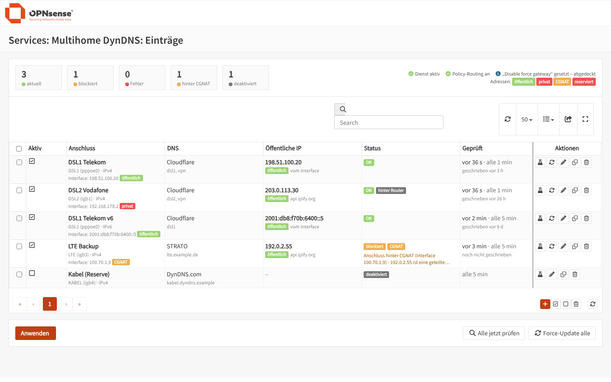
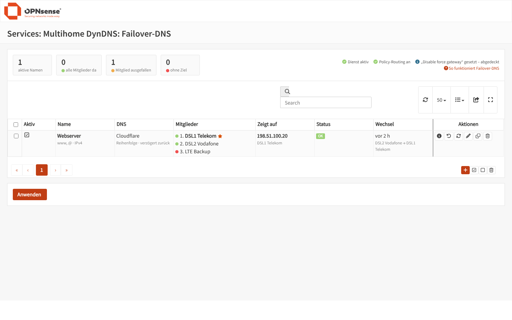
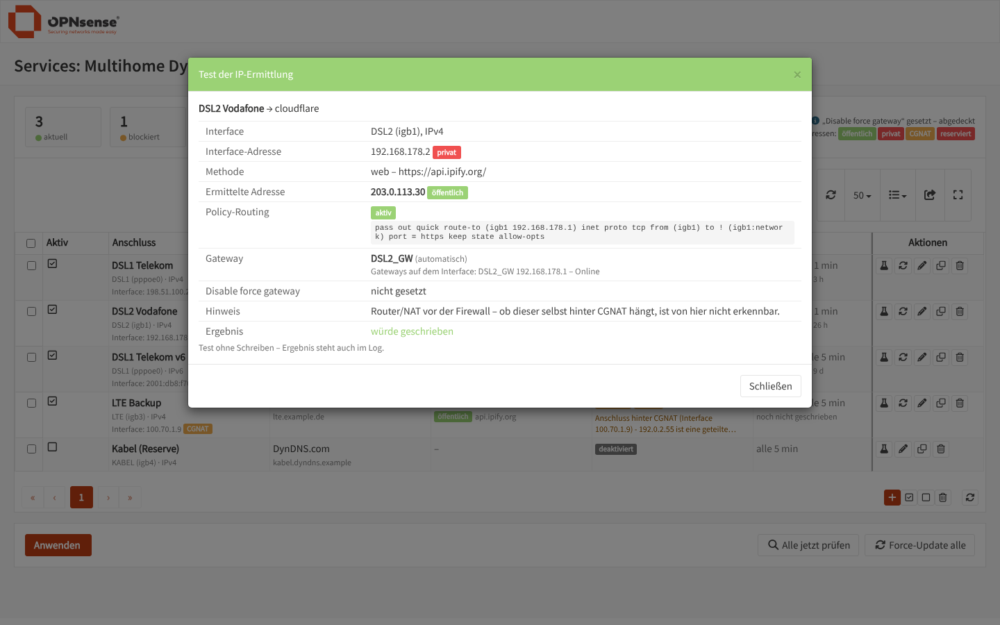
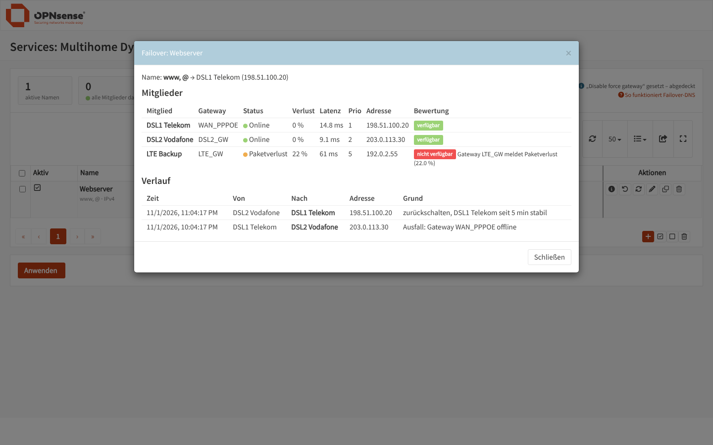
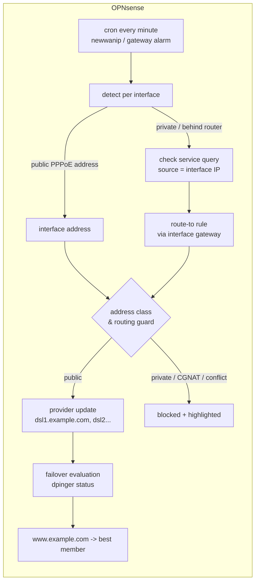

# os-multihome-ddns – Multihome DynDNS for OPNsense

[](https://github.com/pilotofpackets/os-multihome-ddns/actions/workflows/tests.yml)
[](LICENSE)


**Dynamic DNS for firewalls with more than one internet connection.**

Every DynDNS entry is bound to an interface and always publishes **that interface's**
public IP – not the one of the default route. On top of that, **failover names** always
point to a connection that is currently up.

> 🇩🇪 Deutsche Anleitung: [README.de.md](README.de.md)

---

## Why?

With several WAN connections, the stock ddclient plugin often reports the **same IP for
every entry**. The check request (ipify & co.) is sent by the firewall itself, and
locally generated traffic follows the default route.

OPNsense only routes it through the "right" WAN via its automatic *force gateway* rules,
which are missing when:

- *Firewall › Settings › Advanced › "Disable force gateway"* is set (common in multi-WAN setups),
- the interface has no gateway assigned as interface/upstream gateway (e.g. static IP behind a router),
- or a `quick` rule of your own matches first.

**os-multihome-ddns generates its own policy routing rules per interface**, independent of
"Disable force gateway":

```
pass out quick route-to (<if> <gw>) proto tcp from (<if>) to !<if-net> port {80,443}
pass out quick route-to (<if> <gw>) proto udp from (<if>) to !<if-net> port 53
```

The rules match on the **source address**, so all interfaces can use the very same check
service (e.g. all of them ipify) at the same time.

## Features

| | |
|---|---|
| **Per-interface detection** | Public interface address (e.g. PPPoE) is used directly, otherwise a check service is queried *through* that interface. IPv4 and IPv6, optional IPv6 host part replacement. |
| **Check services** | Same list as os-ddclient: akamai, cloudflare (web and DNS `whoami.cloudflare`), dynu, freedns, he, icanhazip, ipify, loopia, myonlineportal, noip, nsupdate.info, zoneedit, custom URL. |
| **Providers** | The native providers of os-ddclient: all-inkl (KAS), Amazon Route 53, Azure, Cloudflare, deSEC, DigitalOcean, DNS-O-Matic, DNSPod, Domeneshop, Duck DNS, DynDNS, Dynu, Gandi, HE.net, Hetzner, Hostinger, INWX, Loopia, netcup, No-IP, nsupdate.info, OVH, Porkbun, PowerDNS, spDYN, STRATO and custom dyndns2/GET/POST/PUT. |
| **Cloudflare round robin** | Several connections may maintain the same name; each entry owns its record (tagged via the record comment). |
| **Address protection** | Private (RFC 1918 / RFC 4193), reserved (RFC 6890) and CGNAT (RFC 6598) addresses are highlighted and **never written**. Connections behind CGNAT are flagged and skipped (configurable). |
| **Routing guard** | If a check service returns an address that already belongs to another interface, nothing is written and the status points to the routing problem. |
| **Failover DNS** | A name (e.g. `www`) follows the best available member, based on dpinger gateway status (down, packet loss, latency or own thresholds). Strategies: order, gateway priority, lowest latency. Failback: immediate, delayed, manual. |
| **Fast reaction** | Interval per entry down to 1 minute, immediate check on address change (PPPoE reconnect) and immediate failover on gateway alarms. |
| **Force update** | Per entry, for selected entries or all. |
| **Full logging** | Five log levels up to debug (addresses, requests/responses, gateway status, policy rules, decisions, provider API calls) in its own log file. |
| **Gateway per entry** | Automatic (interface gateway, otherwise any enabled gateway on the interface) or chosen explicitly – used for the route-to rule and the failover health. |
| **Test button** | Shows detected address, address classes, method, gateway and the active route-to rule – without writing anything. |

## Screenshots

| Entries | Failover DNS |
|---|---|
|  |  |
| **Test dialog** – detected address, address classes, gateway, active route-to rule | **Failover details** – member health (dpinger) and switch history |
|  |  |

<sub>Sample data with documentation IP ranges, rendered with the stock OPNsense theme (`tools/preview`).</sub>

## How it works



## Requirements

- OPNsense with a current release (developed against the 26.x code base)
- Only stock components: `curl`, `python3`, `requests`, `dnspython`
- Optional: `boto3` for Amazon Route 53 (the installer tries to add it)

## Installation

Log in to the firewall via SSH as `root` (console menu option **8**, Shell) and run:

```sh
fetch -o /tmp/mhddns.tar.gz https://github.com/pilotofpackets/os-multihome-ddns/archive/refs/heads/main.tar.gz
tar -xzf /tmp/mhddns.tar.gz -C /tmp
sh /tmp/os-multihome-ddns-main/install.sh
```

SSH can be enabled under *System › Settings › Administration › Secure Shell*.

Then reload the web UI. The plugin lives under **Services › Multihome DynDNS**.

**Updating:** run the same three commands again. Settings are kept in `config.xml`; an installation of the former *Multi-WAN DynDNS* (2.0) is taken over automatically, including its settings.

**Uninstalling:** `sh /tmp/os-multihome-ddns-main/uninstall.sh` (settings stay in `config.xml`).

After a full reinstall of the firewall, run the installer again; your settings come back with the config backup.

## Configuration

1. **Entries** – one entry per connection and IP version:
   - interface
   - detection *Automatic*
   - check service (any – they may be the same for all interfaces)
   - provider, credentials, zone and host names (e.g. `dsl1`, `dsl2`)
2. **Settings** – tick *Enabled*, choose a log level, then click *Save and apply*. This loads the policy routing rules and the schedule.
3. Use the 🧪 **test** button on each entry to verify the detected address and the routing rule.
4. **Failover DNS** (optional):
   - create a name (e.g. `www`) and select the member entries
   - choose strategy and failback, then click *Apply*

Verify the rules on the shell: `pfctl -sr | grep route-to`

### Failover DNS in practice

| Name | Points to | Purpose |
|---|---|---|
| `dsl1.example.com` | always DSL 1 | fixed, matches reverse DNS / PTR |
| `dsl2.example.com` | always DSL 2 | fixed, matches reverse DNS / PTR |
| `www.example.com` | best available line | service name for clients, follows failover |

A member is considered **down** when:
- its gateway is *offline* (always),
- *packet loss* or *latency* alarms are reported (optional),
- your own loss or latency thresholds are exceeded (optional),
- or its own address detection fails or is blocked.

Gateway thresholds themselves are configured under *System › Gateways*.

### Cloudflare API token

*My Profile › API Tokens › Create Token › "Edit zone DNS"* with **Zone › DNS › Edit** and
**Zone › Zone › Read**, restricted to the zone. Leave *username* empty for tokens; an
e-mail address as username switches to the legacy global API key.

## Troubleshooting

| Symptom | Cause / fix |
|---|---|
| Status *blocked*: "also assigned to interface …" | The query left through the wrong gateway. Click *Apply*, then check the test dialog for an active route-to rule. Is a gateway configured on that interface? |
| Test dialog: "no rule active" | No usable gateway found on the interface (*System › Gateways*) or settings not applied yet. |
| Orange **CGNAT** badge | The interface has a 100.64.0.0/10 address. The line is not reachable from outside via IPv4 – ask your ISP for a public IPv4 or use IPv6. |
| Red **private** badge on the public IP | A check service or the interface returned a private address. It is never written; use *check service* instead of *interface address*. |
| Nothing happens | Is the service enabled under *Settings*? Set log level *Debug* and look at *Log File*. |

Files on the firewall:

- state: `/var/db/multihomeddns/state.json`
- log: `/var/log/multihomeddns/`

## Development

```
multihome-ddns/                      plugin in opnsense/plugins layout (dns/multihome-ddns)
├── Makefile, pkg-descr
└── src/
    ├── etc/inc/plugins.inc.d/multihomeddns.inc        firewall rules, cron, newwanip/monitor hooks, syslog
    └── opnsense/
        ├── mvc/app/…/MultihomeDDNS/                   model, API + UI controllers, forms, views
        ├── scripts/multihomeddns/
        │   ├── multihomeddns.py                       CLI used by configd
        │   ├── gateways.php                          gateways + dpinger status as JSON
        │   └── lib/                                  detect, runner, failover, log, config
        │       └── account/                          provider modules (from os-ddclient, Cloudflare own)
        └── service/                                  configd actions, syslog filter
tests/                              scenario tests with simulated interfaces, gateways, pf and APIs
tools/preview/                      renders the pages with the OPNsense theme and takes screenshots
install.sh / uninstall.sh           direct installation without building a package
```

Run the tests locally (Python 3 with `requests` and `dnspython`, optional `php-cli`):

```sh
sh tests/run.sh
```

Screenshots of the UI with the real OPNsense theme (needs a checkout of
[opnsense/core](https://github.com/opnsense/core) and `pip install playwright`):

```sh
sh tools/preview/run.sh /path/to/opnsense-core
```

To build a real package, copy `multihome-ddns/` to `dns/multihome-ddns` in a checkout of
[opnsense/plugins](https://github.com/opnsense/plugins) and run `make package`.

The web UI is currently in German. Translations and pull requests are welcome.

## Credits & license

BSD 2-Clause, see [LICENSE](LICENSE).

The provider modules in `lib/account/` and the list of check services are taken from
[os-ddclient](https://github.com/opnsense/plugins/tree/master/dns/ddclient)
(© Ad Schellevis, Deciso B.V. and contributors, BSD 2-Clause). This is a community
project and not affiliated with the OPNsense project or Deciso B.V.
